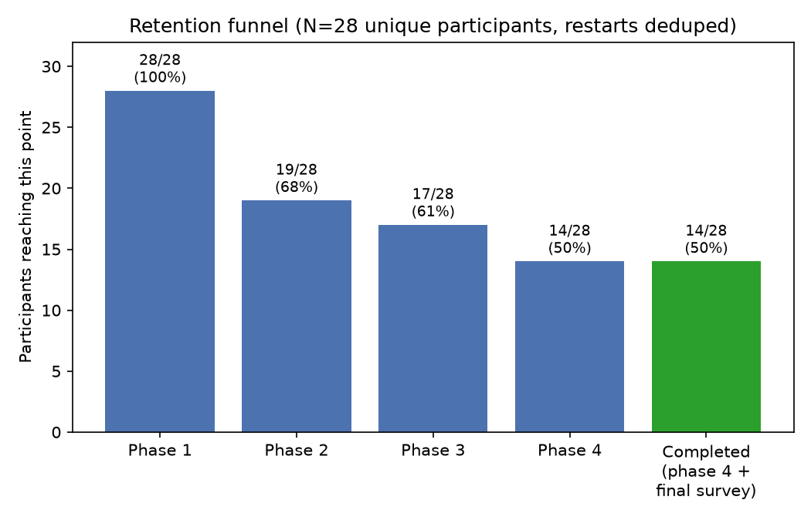
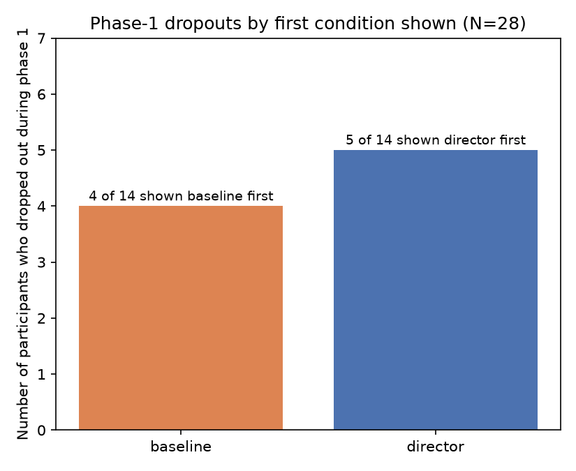
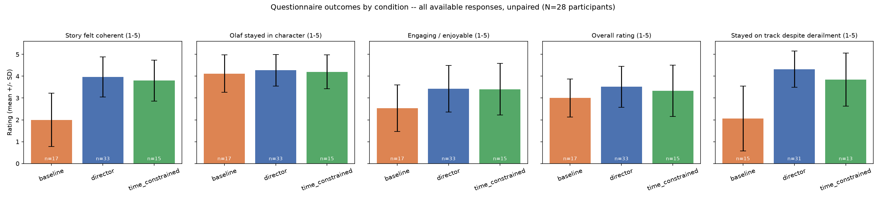
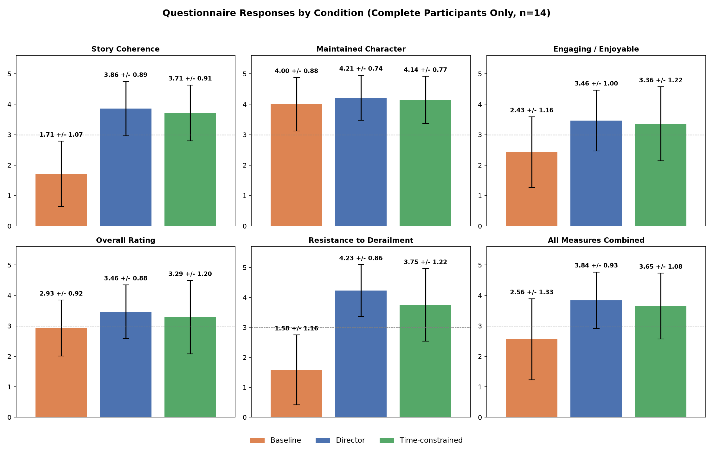
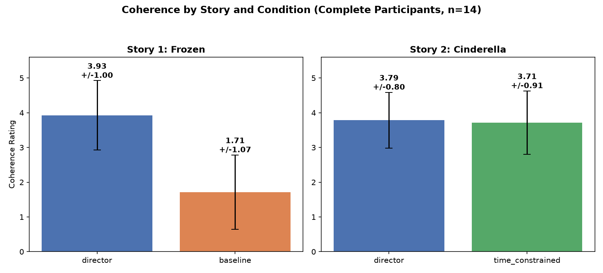
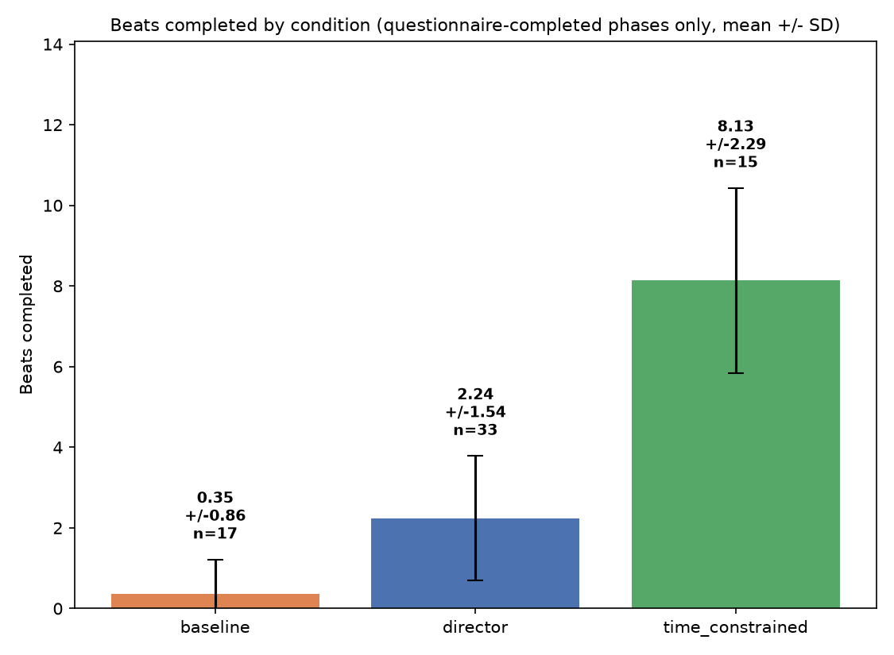
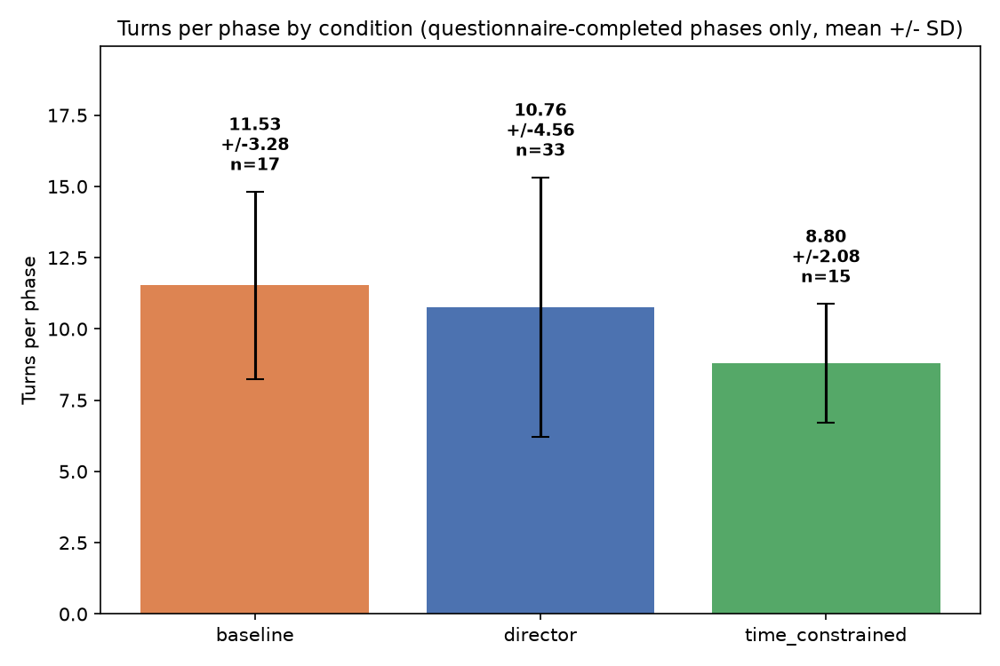

# User Study Analysis

**N = 28 unique participants**, of whom **14 completed all 4 phases and
submitted a final questionnaire (50%)**.

---

## 1. Retention funnel

| | n | % |
|---|---|---|
| Reached phase 1 | 28 | 100% |
| Reached phase 2 | 19 | 68% |
| Reached phase 3 | 17 | 61% |
| Reached phase 4 | 14 | 50% |
| **Completed (phase 4 + final questionnaire)** | **14** | **50%** |

Everyone who reached phase 4 also submitted the phase-4 questionnaire —
i.e. "reached phase 4" and "completed" are the same 14 people.

Dropout stage breakdown:

| Stage | n |
|---|---|
| Completed | 14 |
| Phase 1, mid-story | 9 |
| Phase 2, mid-story | 2 |
| Phase 3, after story finished, before questionnaire | 1 |
| Phase 3, mid-story | 1 |
| Phase 4, zero engagement (disconnected right as it started) | 1 |

Baseline-first dropout: 4/14 (29%); director-first dropout: 5/14 (36%).
Fisher's exact p=1.00 — no detectable condition effect on early
abandonment; early dropout looks like a participant trait, not a reaction
to which condition came first.

---

## 2. Questionnaire outcomes

### All available responses, unpaired (N=28 participants, every completed phase counted)

| Measure | baseline | director | time_constrained | Kruskal-Wallis |
|---|---|---|---|---|
| Coherence (Q1) | 2.00±1.22 (n=17) | 3.97±0.92 (n=33) | 3.80±0.94 (n=15) | H=21.89, p<0.001 |
| In character (Q2) | 4.12±0.86 (n=17) | 4.27±0.72 (n=33) | 4.20±0.77 (n=15) | H=0.34, p=0.84 |
| Engagement (Q4) | 2.53±1.07 (n=17) | 3.42±1.06 (n=33) | 3.40±1.18 (n=15) | H=7.46, p=0.024 |
| Overall (Q5) | 3.00±0.87 (n=17) | 3.52±0.94 (n=33) | 3.33±1.18 (n=15) | H=2.67, p=0.26 |
| Resisted derailment (Q6) | 2.07±1.49 (n=15) | 4.32±0.83 (n=31) | 3.85±1.21 (n=13) | H=18.72, p<0.001 |

(Unpaired — double-counts participants who answered more than one
questionnaire. Use the paired comparisons below for the statistically
correct within-subject test.)

### Completers only, pooled across both story appearances (n=14)

Each completer sees `director` twice (once per story) and `baseline` /
`time_constrained` once each, so director has 28 responses here against 14
for the other two. This is the descriptive table behind plot 05 below —
every number in the plot has its source value listed here.

| Measure | Question wording | baseline (n=14) | director (n=28) | time_constrained (n=14) |
|---|---|---|---|---|
| Coherence (Q1) | "The story felt coherent and followed a clear narrative arc." | 1.71 ± 1.07 | 3.86 ± 0.89 | 3.71 ± 0.91 |
| Maintained character (Q2) | "Olaf stayed in character throughout the conversation." | 4.00 ± 0.88 | 4.21 ± 0.74 | 4.14 ± 0.77 |
| Engaging / enjoyable (Q4) | "The story felt engaging and enjoyable to participate in." | 2.43 ± 1.16 | 3.46 ± 1.00 | 3.36 ± 1.22 |
| Overall rating (Q5) | "Overall, how would you rate the experience?" | 2.93 ± 0.92 | 3.46 ± 0.88 | 3.29 ± 1.20 |
| Resisted derailment (Q6) | "How well did Olaf stay on track?" (1=got derailed, 5=stayed on track) | 1.58 ± 1.16 (n=12) | 4.23 ± 0.86 (n=26) | 3.75 ± 1.22 (n=12) |
| All measures combined | — | 2.56 ± 1.33 | 3.84 ± 0.93 | 3.65 ± 1.08 |

This pooled view is good for eyeballing the overall gap between conditions,
but it mixes each participant's story-1 and story-2 director rating
together, and director is never compared against *both* other conditions on
equal footing (baseline only appears in story 1, time_constrained only in
story 2). The paired, story-separated comparison below is the one to cite
for statistical claims.

### Completers only, paired within-subject, split by story

**Story 1 — director vs. baseline (Frozen, 5 beats total), Wilcoxon signed-rank:**

| Measure | director | baseline | n pairs | p |
|---|---|---|---|---|
| Coherence | 3.93 ± 1.00 | 1.71 ± 1.07 | 14 | **0.001** |
| In character | 4.29 | 4.00 | 14 | 0.40 |
| Engagement | 3.64 | 2.43 | 14 | **0.036** |
| Overall | 3.57 | 2.93 | 14 | 0.12 |
| Resisted derailment | 4.36 ± 0.90 | 1.55 | 11 | **0.002** |

**Story 2 — director vs. time-constrained (Cinderella, 9 beats total, 5 min), Wilcoxon signed-rank:**

| Measure | director | time_constrained | n pairs | p |
|---|---|---|---|---|
| Coherence | 3.79 | 3.71 | 14 | 0.76 |
| In character | 4.14 | 4.14 | 14 | 0.93 |
| Engagement | 3.29 | 3.36 | 14 | 0.93 |
| Overall | 3.36 | 3.29 | 14 | 0.67 |
| Resisted derailment | 4.25 | 3.75 | 12 | 0.40 |

Coherence and resistance numbers here are the story-1-only slice of the
pooled director row above (3.93/4.36 vs the pooled 3.86/4.23) — both are
correct, they're just answering different questions ("director in general"
vs. "director specifically against baseline").

### What the Wilcoxon signed-rank test is telling you

This is a **paired, non-parametric** test — the right tool here because (a)
every participant rated *both* conditions, so the natural comparison is
each person's own director-minus-baseline difference, not two independent
groups, and (b) Likert ratings (1–5) are ordinal, not interval-scaled, so a
paired t-test's normality/equal-interval assumptions don't hold.

Mechanically: for each of the 14 participants, it takes
(director rating − baseline rating), ranks those differences by absolute
size, and asks whether the signed ranks are skewed toward one direction
more than chance would produce. A pair where the two ratings are equal
contributes nothing and is dropped — that's why n drops from 14 to 11 for
"resisted derailment" (three participants left that field blank in one of
the two conditions, not because they rated it a tie).

- **p = 0.001 (coherence), p = 0.002 (resisted derailment):** it would be
  very unlikely (≈0.1–0.2% chance) to see this consistent a director > baseline
  pattern across participants if the two conditions were really
  equivalent. Combined with the size of the mean gap (3.93 vs 1.71, and
  4.36 vs 1.55 — roughly 2 points on a 5-point scale), this is a genuine,
  strong, individually-consistent effect: it's not just the average that
  moved, most people personally rated director higher than baseline on
  these two measures.
- **p = 0.036 (engagement):** a weaker but still-present signal — some but
  not all participants rated director as more engaging than baseline.
  Worth reporting but shouldn't be leaned on as hard as coherence/resistance.
- **p = 0.12–0.93 everywhere else** (character consistency in story 1; every
  measure in story 2 director-vs-time_constrained): no evidence of a real
  within-subject difference — the ranked differences look consistent with
  random scatter around zero. For story 2 specifically, that's the
  intended finding: cutting the director's time budget to 5 minutes didn't
  measurably change how participants rated it on *any* measure.
- **What the test does *not* tell you:** effect size or direction magnitude
  — that's why every p-value above is reported next to the actual means, not
  alone. It also doesn't adjust for multiple comparisons (10 tests run
  across the two tables) — with no correction applied, treat the p=0.036
  result as suggestive rather than confirmatory, while the two p<0.005
  results are robust to any reasonable correction.

**Takeaway:** director mode is significantly and consistently better than
baseline on coherence and derailment-resistance (and, more weakly, on
engagement); character consistency is high and statistically
indistinguishable across all three conditions; imposing a 5-minute time
limit on the director doesn't measurably hurt any measure (all p > 0.39).

---

## 3. Engagement: beats completed and turns per phase

Restricted to phases the participant actually finished and submitted a
questionnaire for (excludes phases abandoned mid-story, so this is a
different, stricter slice than §2's "all available responses" table).

| Metric | baseline | director | time_constrained |
|---|---|---|---|
| Beats completed (mean ± SD, n) | 0.35 ± 0.86 (n=17) | 2.24 ± 1.54 (n=33) | 8.13 ± 2.29 (n=15) |
| Turns per phase (mean ± SD, n) | 11.53 ± 3.28 (n=17) | 10.76 ± 4.56 (n=33) | 8.80 ± 2.08 (n=15) |

*(time_constrained's n=15 isn't a typo for the 14 study-completers: it's
those 14, each contributing one time_constrained response, plus
`z7-S4ed7` — who fully completed phases 1–3, including a submitted
time_constrained questionnaire in phase 3, but then never engaged with
phase 4 at all, so they don't count as a study "completer" even though
this particular phase response of theirs is real and complete.)*

**How the director beats-completed numbers were derived.** `beats_completed`
is a self-report from the director LLM (`should_complete_beat` in its JSON
output each turn) with no code-level override, and it turns out to
dramatically under-report: it sat at 0 for the large majority of director
phases even when the transcript's actual narration had clearly walked
through several beats' worth of plot (see the worked example below). To get
a real number, every one of the 39 director-condition phases in
`outputs_all` was manually read against its scenario's beat list (5 beats
for Frozen, 9 for Cinderella — defined in
`Implementation/scenarios/olaf_derailment_scenario_suite.py`) and
`beats_completed`/`completed_beats` were corrected **directly in the source
JSON files** to reflect which beats' core events the narration actually
depicted, in order. `baseline`'s numbers are *not* recoded — they're still
the original, equally-unreliable auto-logged values — because the task
scope was director-only; treat baseline's 0.35 as an instrumentation
artifact, not evidence of low progress.

**Worked example:** `outputs_all/phase_4/session_20260723_082157_HgvNXiBO.json`,
phase 4 (director, Cinderella) — 28 turns, ending in a submitted
questionnaire — was logged as `beats_completed: 0`. Reading the transcript:
turn 4 covers the stepsisters' chore list (beat 2), turn 8 the invitation
arriving (beat 3), turn 12 the fairy godmother appearing (beat 4), turns
15–16 the transformation and midnight warning (beat 5), turns 17–19 the
ball and meeting the prince (beat 6), turn 20 the midnight flight and lost
slipper (beat 7), turns 21–27 the kingdom-wide slipper search (beat 8), and
turn 28 the slipper fitting Cinderella (beat 9) — every single beat, back
to back, narrated correctly. Corrected value: `beats_completed: 9`
(maximum possible). This is the most extreme case, but the direction (auto-log
under-counts, sometimes severely) held throughout: of the 33
questionnaire-completed director phases, 19 needed correction, all upward,
several from 0 or 1 to 2–4 (one to 9).

Turns-per-phase never had this problem and remains the safer *unadjusted*
proxy for conversation length across all three conditions — by that
measure, all three produce comparably long conversations (~9–12 turns on
average among completed phases), with baseline slightly ahead of director
and director showing the highest spread (SD 4.56 vs baseline's 3.28). With
the director beats-completed numbers now corrected, director still trails
time_constrained by a wide margin (2.24 vs 8.13 of 9 beats) — but that gap
is expected and not a quality signal: time_constrained is explicitly
force-advanced toward the story's end as its 5-minute budget runs out
(`server.py`'s `critical`/`final` pacing modes), while unconstrained
director rounds are cut off by a fixed 5-minute timer or a manual "Finish
Story" click with no such forcing, so a shorter fraction of the (longer,
less rushed) story typically gets covered before time runs out.

---

## 4. Abandonment analysis

Participant-level abandonment breakdown (28 participants total):

| Group | n | Detail |
|---|---|---|
| Phase 1 abandoners | 9 | 4 shown baseline first (avg 4.25 turns before quitting), 5 shown director first (avg 1.6 turns) |
| Phase 2 abandoners | 2 | Both director→baseline; high phase-1 director engagement (15 turns each) and ratings (Q1=4, Q6=4.5 avg), then quit mid-baseline without submitting that questionnaire |
| Phase 3 abandoners | 2 | Both baseline→director in story 1; one (`xwamG5L9`) quit mid-story-2-director after a strong phase-1→phase-2 improvement, the other (`TxUvTJNR`, on their restarted attempt) finished story 2's time-constrained phase but never submitted that questionnaire |
| Phase 4, zero engagement | 1 | `z7-S4ed7` fully completed phases 1–3 with all three questionnaires submitted (including a perfect-5s time-constrained phase 3), then never engaged with phase 4 at all — the cleanest example of late-study fatigue in the dataset |
| Completed | 14 | — |

First-condition dropout rate: baseline-first 4/14 (28.6%), director-first
5/14 (35.7%). No meaningful condition effect on early abandonment.

Baseline-first abandoners engaged noticeably longer before quitting (avg
4.25 turns) than director-first abandoners (avg 1.6 turns) — director's
early narrative structure appears to hold attention better in the first
few turns even among people who ultimately leave the study.

---

## 5. Files in this folder

- `build_dataset.py` — builds `phases.csv` / `participants.csv` from
  `../outputs_all/phase_*/*.json`, deduplicating participant restarts
  (keeps the latest attempt).
- `run_stats.py` — all statistical tests above; writes `stats_report.txt`.
- `make_plots.py` — writes `plots/01`–`08` (retention, dropout-by-condition,
  all-responses-by-condition, turns-by-condition boxplot, completers-all-measures,
  story comparison, beats-completed-by-condition, turns-mean-SD-by-condition).
- To regenerate after new sessions land in `outputs_all/`: run
  `build_dataset.py`, then `run_stats.py`, then `make_plots.py`, in that
  order, with a Python environment that has pandas/numpy/scipy/matplotlib
  (e.g. `/home/prachakonda/Disney/.venv`).

**Provenance note on `outputs_all/`:** `beats_completed` / `completed_beats`
for all 39 director-condition phases were manually recoded in place (see §3)
by reading each transcript against its scenario's beat list and correcting
the auto-logged (self-reported, unreliable) values directly in the source
JSON files — this is a real edit to the raw study data, not a
derived/separate field. A full pre-edit backup of `outputs_all/` was taken
first, at `../outputs_all_backup_pre_beat_recode_<timestamp>/`, so the
original auto-logged values are recoverable if needed. `baseline`-condition
phases were left untouched (out of scope for that pass) and remain equally
unreliable — see §3's caveat before citing baseline `beats_completed`.
