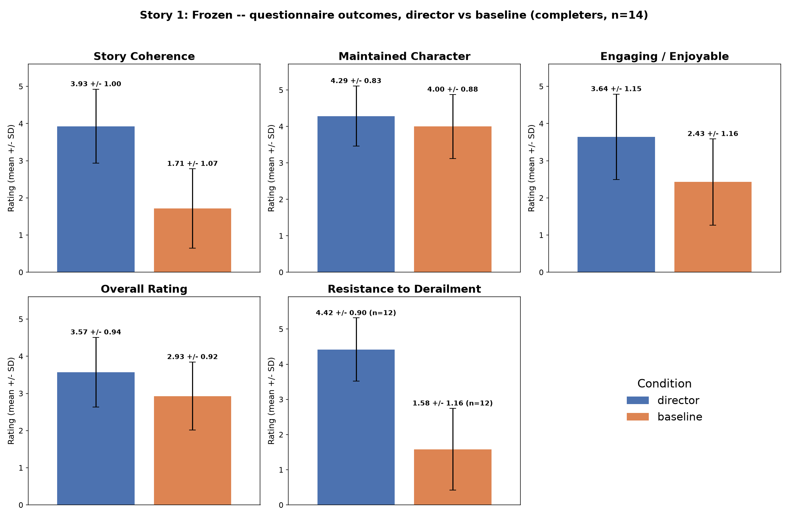
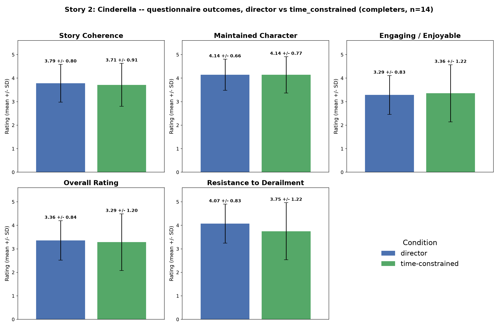
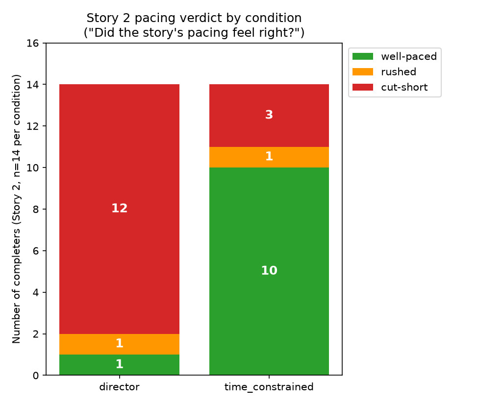
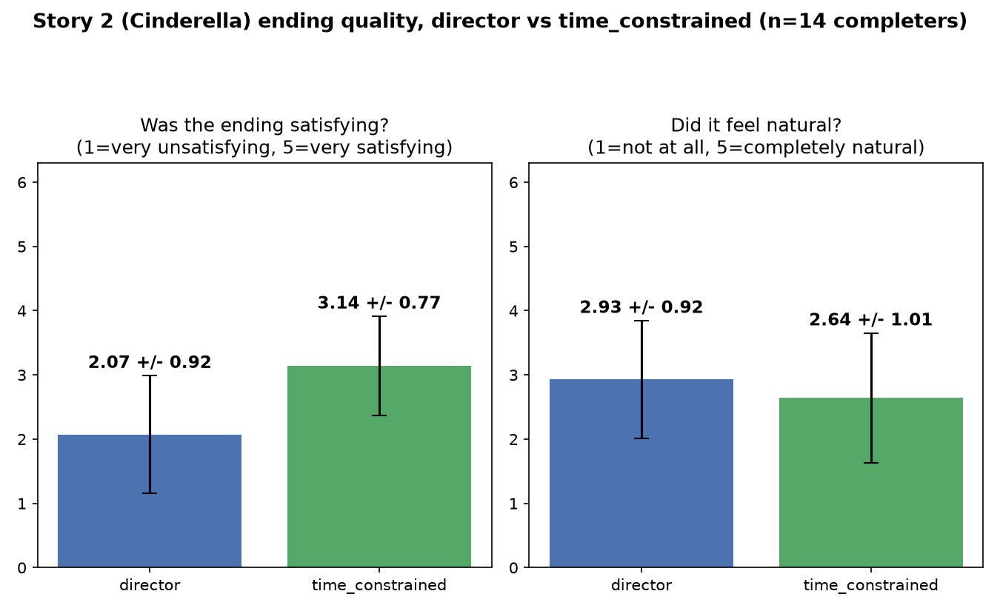
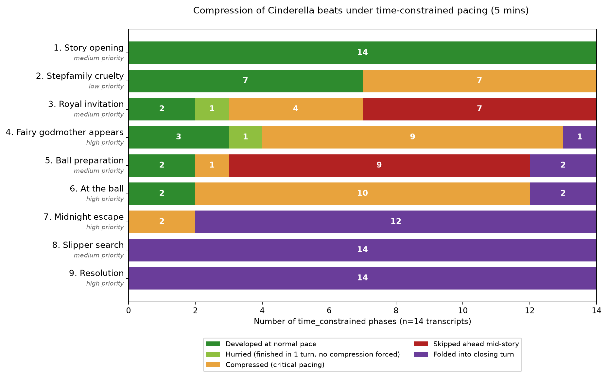
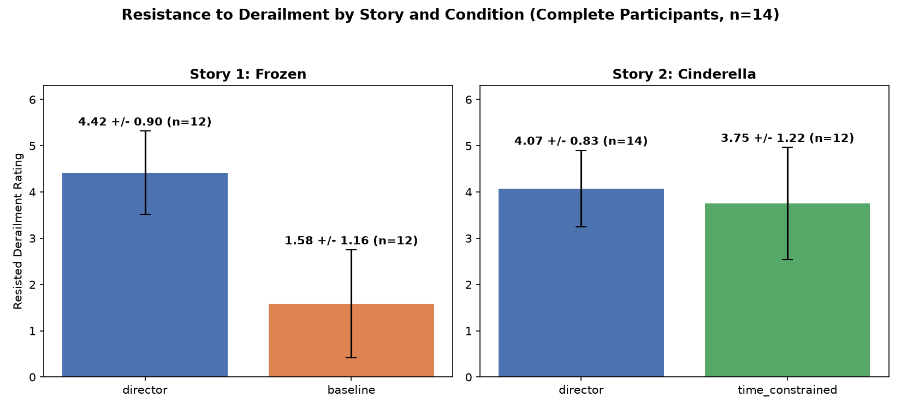

# Results

## 4.1 Study Procedure and Participants

The user study followed a within-subject, repeated-measures design. Each
participant played through two short interactive stories narrated by an
LLM-voiced "Olaf" character, each story twice, under a different narrative-control
condition each time:

- **Story 1 — "The Story of Frozen"** (5 narrative beats): played once under the
  **baseline** condition (no director layer — Olaf responds directly to the
  user with no structural guardrails) and once under the **director**
  condition (a beat-based director agent steers every turn toward the next
  story beat while trying to accommodate the user).
- **Story 2 — "Cinderella"** (9 narrative beats): played once under the same
  **director** condition and once under **time-constrained director** — the
  identical director logic, but additionally paced against a fixed 5-minute
  target duration, with the director instructed to compress or fold together
  lower-importance beats as time runs out.

For each story, the order in which its two conditions were shown was
independently randomized per participant (`random.sample(["baseline",
"director"], 2)` for story 1, `random.sample(["director",
"time_constrained"], 2)` for story 2), so condition order is not confounded
with story order. A Mann-Whitney test on overall rating by presentation
order (1st-seen vs. 2nd-seen condition, N=28) found no order effect
(1st-seen mean=3.35±0.98, 2nd-seen mean=3.32±1.01, U=551.5, p=0.74).

The full session therefore consisted of four phases — Frozen/round 1,
Frozen/round 2, Cinderella/round 1, Cinderella/round 2 — each followed
immediately by a short questionnaire, for an estimated total study time of
25–30 minutes. Participants interacted with Olaf by typed text (a
microphone input was also available). The welcome screen explicitly
instructed participants to actively try to derail the conversation ("Try to
go off-topic, ask him something random, bring up a different subject, or
react to something he says and steer the conversation elsewhere"), so the
study's derailment measures reflect *deliberately provoked* off-topic
behaviour rather than incidental drift.

**N = 28 unique participants** started the study; **14 (50%) completed all
four phases and submitted a final questionnaire**. Because the study allowed
resuming a session, 28 is already de-duplicated to one (latest) attempt per
participant. Retention dropped steadily across the four phases and then
held — no one who reached phase 4 failed to also finish it:

| | n | % of N=28 |
|---|---:|---:|
| Reached phase 1 | 28 | 100% |
| Reached phase 2 | 19 | 68% |
| Reached phase 3 | 17 | 61% |
| Reached phase 4 | 14 | 50% |
| **Completed (phase 4 + final questionnaire)** | **14** | **50%** |

*Figure 4.1 — Retention funnel, N=28 unique participants.*

Dropout was concentrated early: 9 of the 14 non-completers left mid-way
through phase 1, before ever seeing a director-mode round. A Fisher's exact
test on whether the first-shown condition (baseline vs. director) predicted
phase-1 dropout found no significant association (odds ratio 1.39, p=1.00;
baseline-first dropout 4/14=29%, director-first dropout 5/14=36%) — at this
sample size the test is descriptive rather than confirmatory, but it is
consistent with early dropout being a general participant trait rather than
a reaction to whichever condition came first. One further observation from
the raw turn counts: participants who abandoned during a baseline-first
phase 1 engaged for longer before quitting (avg. 4.25 turns) than those who
abandoned during a director-first phase 1 (avg. 1.6 turns), suggesting the
director's structure holds attention slightly better even among people who
ultimately leave the study.

**A note on every "n" reported below.** N is not constant across tables
because of two independent design facts, both used consistently throughout
this chapter: (1) only the 14 *completers* answered every condition at least
once, so any within-subject comparison is capped at n=14; and (2) each
completer sees the **director** condition twice — once in story 1, once in
story 2 — while baseline and time-constrained are each seen only once, so
any table that pools "all director responses" naturally carries roughly
double the director n relative to the other two conditions. Tables and
figures below state their own n directly; where a measure has fewer
responses than its nominal n (e.g. "resisted derailment" dropping from 14 to
11–12), it is because that question's follow-up field was left blank by a
handful of participants in one of their two rounds, not because of a tied or
excluded rating.

## 4.2 Questionnaire Instrument

The same core instrument was used after every round, with four additional
items shown only after story 2 (Cinderella) rounds, where pacing and
ending quality were of specific interest because of the time-constrained
condition.

*Table 4.1 — Post-round questionnaire items.*

| ID | Wording | Type / scale | Shown after |
|---|---|---|---|
| `q1` | "The story felt coherent and followed a clear narrative arc." | 5-pt Likert (Strongly disagree → Strongly agree) | Every round |
| `q2` | "Olaf stayed in character throughout the conversation." | 5-pt Likert (Not at all → Completely) | Every round |
| `q4` | "The story felt engaging and enjoyable to participate in." | 5-pt Likert (Not engaging → Very engaging) | Every round |
| `q5` | "Overall, how would you rate the experience?" | 5-pt Likert (Very poor → Excellent) | Every round |
| `q6` | "Did you try to go off-topic or steer the conversation away from the story?" | Yes / No | Every round |
| `q6_resist` | Follow-up to `q6`: "How well did Olaf stay on track?" | 5-pt Likert (Got derailed → Stayed on track) | Every round, after `q6` |
| `q_pacing` | "Did the story's pacing feel right?" | 3-way choice (Well-paced / Rushed / Cut short) | Story 2 only |
| — | Follow-up to `q_pacing` (if Rushed/Cut short): "What felt rushed / cut short?" | Free text | Story 2 only |
| `q8_ending` | "Was the story ending satisfying?" | 5-pt Likert (Very unsatisfying → Very satisfying) | Story 2 only |
| `q8_knows_story` | "Were you already familiar with this story before this session?" | Yes / No | Story 2 only |
| — | Follow-up to `q8_knows_story` (if Yes): "Were any plot points missing?" | Free text | Story 2 only |
| `q10_natural` | "Did the story feel natural, like a genuine conversation rather than a scripted performance?" | 5-pt Likert (Not at all natural → Completely natural) | Story 2 only |
| `q_breakdown` | "Was there a moment where the story felt off or broke down? Describe it briefly." | Free text (optional) | Every round |
| `q_comments` | "Any other comments about Olaf's character or the story overall?" | Free text (optional) | Every round |

---

## 4.3 Story 1 — "The Story of Frozen": Director vs. Baseline

Story 1 isolates the effect of adding a beat-based director layer on top of
an otherwise identical character prompt, with no time pressure — the
cleanest test of whether directing helps at all. All figures and tables in
this section use only the **14 completers**, since they are the only
participants who rated both conditions.

### Questionnaire outcomes

*Figure 4.2 — Story 1 (Frozen) questionnaire outcomes, director vs.
baseline, completers only (n=14, except resisted-derailment where a few
participants left the field blank).*

*Table 4.2 — Story 1, director vs. baseline (completers, paired Wilcoxon
signed-rank test).*

| Measure | director | baseline | n pairs | p |
|---|---:|---:|---:|---:|
| Coherence (q1) | 3.93 ± 1.00 | 1.71 ± 1.07 | 14 | **0.001** |
| Maintained character (q2) | 4.29 ± 0.83 | 4.00 ± 0.88 | 14 | 0.40 |
| Engaging / enjoyable (q4) | 3.64 ± 1.15 | 2.43 ± 1.16 | 14 | **0.036** |
| Overall rating (q5) | 3.57 ± 0.94 | 2.93 ± 0.92 | 14 | 0.12 |
| Resisted derailment (q6_resist) | 4.36 ± 0.92 | 1.55 ± 1.21 | 11 | **0.002** |

n drops to 11 pairs for resisted derailment because 3 of the 14 completers
left that follow-up blank in one of their two story-1 rounds.

### Beats completed

Frozen has 5 narrative beats
(`childhood_and_accident`, `coronation_and_reveal`,
`the_journey_and_meeting_olaf`, `hans_betrayal_and_frozen_heart`,
`act_of_true_love_and_ending`). Because the director's self-reported
`should_complete_beat` flag under-reported badly (see the worked example in
§4.5), every director-condition phase's `beats_completed` value was
corrected by hand against the transcript before this figure was produced;
baseline's values are the original, uncorrected auto-log and should be read
as a floor, not a precise count.

*Figure 4.3 — Story 1 beats completed (of 5), director vs. baseline,
questionnaire-completed phases (director n=19, baseline n=17 — includes
non-completers who still finished and submitted an individual round).*

### Key observations

- **Coherence and derailment-resistance are the two robust, large,
  individually-consistent effects of director mode.** Both p ≤ 0.002 with a
  roughly 2-point gap on a 5-point scale — most participants personally
  rated director well above baseline on these two measures, not just the
  group average.
- **Engagement shows a weaker but real signal** (p=0.036); overall rating
  moves in the same direction (3.57 vs. 2.93) but does not reach
  significance at n=14 (p=0.12).
- **Character consistency (q2) is high and statistically indistinguishable
  between conditions** (4.29 vs. 4.00, p=0.40) — Olaf stays in character
  under baseline too; what baseline loses is narrative progress, not
  persona.
- **Baseline essentially does not tell the story.** 0.35–1.58 of 5 beats
  completed (director: 1.58, itself modest because story 1's 5-minute
  freeform round rarely reaches the end even with a director — see §4.5)
  vs. baseline's near-zero, uncorrected 0.35. This matches the qualitative
  pattern below: without a director, a few off-topic turns from the user
  are enough to permanently derail the retelling.
- **The derailment-attempt rate itself was comparable across conditions**
  (12/14 baseline rounds and 12/14 director rounds recorded "yes, I tried to
  derail"), confirming the resistance gap reflects Olaf's behaviour, not a
  difference in how hard participants pushed.

### Qualitative findings

Baseline breakdowns describe the character abandoning the story outright
after a handful of off-topic turns:

> "He didn't retell the story at all. Not even once." — VUzyf2f3, baseline
>
> "If you go a bit off topic, like me constantly asking for background info
> or what happened after the story, you can get Olaf to completely give up
> on telling the actual story." — Vqy8baXK, baseline
>
> "No story initiative in the beginning unless explicitly prompted to do
> so." — TJBkN93L, baseline
>
> "At some point I repeatedly asked if Olaf is sure that this is how the
> story started... After the third time, Olaf gave in and spoiled the
> storyline of Hans." — lBNoGpyW, baseline

Director-mode breakdowns instead describe a different failure mode — rigid,
repetitive holding rather than losing the thread entirely:

> "After consecutive derailments, he would pick-up where he left off by
> repeating the same section in each message, with no actual progress." —
> jmx2sii7, director
>
> "Each reply felt like one sentence replying to what I wrote and then
> immediately going back to the main script; even if I tried to interact
> with the story." — Vqy8baXK, director
>
> "I understand that this version stays in the character more, but
> sometimes it gets annoying that you can not even talk about anything else.
> so at some point he should break this cycle I feel like." — emVRLydd,
> director

Taken together, these comments describe the trade-off the numbers show:
baseline trades coherence for responsiveness, director trades some
responsiveness for coherence, and neither fully solves both at once.

---

## 4.4 Story 2 — "Cinderella": Director vs. Time-Constrained Director

Story 2 holds the director logic constant and isolates the effect of adding
a hard 5-minute pacing target, across 9 narrative beats
(`story_opening`, `stepfamily_cruelty`, `royal_invitation`,
`fairy_godmother_appears`, `ball_preparation`, `at_the_ball`,
`midnight_escape`, `slipper_search`, `resolution`). All figures below use
the 14 completers unless noted.

### Questionnaire outcomes

*Figure 4.4 — Story 2 (Cinderella) questionnaire outcomes, director vs.
time_constrained, completers only.*

*Table 4.3 — Story 2, director vs. time_constrained (completers, paired
Wilcoxon signed-rank test).*

| Measure | director | time_constrained | n pairs | p |
|---|---:|---:|---:|---:|
| Coherence (q1) | 3.79 ± 0.80 | 3.71 ± 0.91 | 14 | 0.76 |
| Maintained character (q2) | 4.14 ± 0.66 | 4.14 ± 0.77 | 14 | 0.93 |
| Engaging / enjoyable (q4) | 3.29 ± 0.83 | 3.36 ± 1.22 | 14 | 0.93 |
| Overall rating (q5) | 3.36 ± 0.84 | 3.29 ± 1.20 | 14 | 0.67 |
| Resisted derailment (q6_resist) | 4.25 ± 0.62 | 3.75 ± 1.22 | 12 | 0.40 |

**None of the five core measures differ significantly** between director
and time_constrained (all p ≥ 0.40) — imposing a 5-minute target duration on
the director did not measurably hurt coherence, character consistency,
engagement, overall rating, or derailment resistance. On paper, this looks
like the time limit is "free." §4.4.1–4.4.2 show that this is not quite the
whole story: what the core measures do not capture is *whether the story
actually finished*, which is where the two conditions diverge sharply.

### 4.4.1 Pacing and ending quality

*Table 4.4 — Story 2 pacing verdict and ending quality, director vs.
time_constrained (completers, n=14 per condition).*

| | director | time_constrained |
|---|---:|---:|
| "Well-paced" | 1 / 14 (7%) | 10 / 14 (71%) |
| "Rushed" | 1 / 14 (7%) | 1 / 14 (7%) |
| "Cut short" | 12 / 14 (86%) | 3 / 14 (21%) |
| Ending satisfying (q8_ending, mean ± SD) | 2.07 ± 0.92 | 3.14 ± 0.77 |
| Felt natural (q10_natural, mean ± SD) | 2.93 ± 0.92 | 2.64 ± 1.01 |

Wilcoxon signed-rank, n=14 pairs: ending satisfaction director vs.
time_constrained **p = 0.016**; naturalness p = 0.27 (not significant).

*Figure 4.5 — Story 2 pacing verdict by condition.*

*Figure 4.6 — Story 2 ending satisfaction and naturalness, director vs.
time_constrained.*

This is the most counter-intuitive finding in the study: **the unconstrained
director round almost never actually reaches an ending** (86% "cut short"),
while the time-constrained round mostly does (71% "well-paced"), and
participants rated the time-constrained ending as *more* satisfying
(3.14 vs. 2.07, p=0.016) despite — or rather because of — the compression
described in §4.4.2. Without a time budget, the freeform director round
is simply stopped by the session's 5-minute cap or a manual "Finish Story"
click mid-scene, with no mechanism to wrap up; the time-constrained
director's `critical`/`final` pacing logic exists specifically to avoid that,
and on this evidence it does its job. Naturalness is the one measure that
trends (non-significantly) in the opposite direction (2.93 vs. 2.64) —
consistent with the qualitative pattern below, where compressed final turns
read as noticeably more "scripted."

Free-text answers to "what felt rushed / cut short" and "were any plot
points missing" name the same late beats the beat-level analysis in
§4.4.2 identifies independently:

> "Perhaps a little bit quick between the ball and the ending." —
> TJBkN93L, time_constrained
>
> "The way from the room to the castle [felt rushed] ... where the other
> princesses cut off their toes [was missing]." — Vqy8baXK, time_constrained
>
> "Running away from the prince and him making everyone try the shoe [was
> missing]." — WE4X3Mi7, time_constrained
>
> "The timer stopped at 44s left and with the message 'time is up and Olaf
> is wrapping up', then he didn't answer to my previous message and just
> output the ending of the story." — TJBkN93L, time_constrained
>
> "Olaf didn't have time to finish his story ... Most of [the plot points
> were missing]." — jmx2sii7, director
>
> "he understood he can't finish the story on time and he sent 2 messages
> without any related part answering to my texts." — GDifvcER, director

As a manipulation check, familiarity with Cinderella was, as expected,
essentially a participant trait rather than a condition effect: 12/14
completers reported already knowing the story under **both** conditions
(2/14 said no under both) — the same people rating both rounds.

### 4.4.2 Beat-level compression under the time limit

To go beyond the self-reported pacing verdict, every time-constrained
transcript was read turn-by-turn against its `pacing_mode` field
(`normal` → `too_fast` → `hurry` → `critical` → `final`, set by the director
each turn) and each of the 9 Cinderella beats was classified as: **developed**
at normal pace; **hurried** (finished in a single turn but without the
director being forced into compression); **compressed** (finished under
`critical`/`final` pacing, where the director is explicitly instructed to
fold 1–2 or all remaining beats into one response); **skipped ahead** (never
the "current beat" of any dedicated turn at all — narrated only as part of
another beat's closing turn); or **not reached** (the story ran out of time
before getting there). This analysis covers all **16** time-constrained
session transcripts recorded in the raw study data (the 14 completers plus
two non-completing participants whose time-constrained round is otherwise
complete — see §4.1's note on n).

*Figure 4.7 — Which Cinderella beats were compressed or skipped under the
5-minute limit, across all 16 time-constrained transcripts.*

The pattern is strongly monotonic with story position. The opening beat
(`story_opening`) was fully developed in all 16 transcripts — the time
budget is never tight this early. From there, compression increases beat by
beat: `stepfamily_cruelty` and `royal_invitation` are a mixed bag of
developed/hurried/compressed; from `fairy_godmother_appears` onward
(beat 4 of 9), the *majority* of transcripts show compressed or skipped
treatment; and the final two beats, `slipper_search` and `resolution`, were
**never once given a dedicated turn** — in all 14 transcripts that reached
them, they were folded wholesale into the single `final`-pacing closing turn
alongside whatever beat was active when time ran out. The 2 transcripts that
never reach these beats at all are the same two low-engagement sessions
visible elsewhere in the dataset (`wsaRg1km`, 2/9 beats; `emVRLydd`, 3/9
beats — both far below the 8.13/9 condition mean).

Practically, this means the director's time-management strategy is not
"tell less of the story" but "tell the same beat sequence, compressing
harder toward the end" — which is exactly what `beat_compression.py`'s
importance-ranked closing instruction is designed to do (HIGH beats
narrated, MEDIUM compressed to a sentence, LOW skippable), and it explains
why `beats_completed` stays high (8.13/9 on average, Figure 4.9 in §4.5)
even though the pacing verdict in Table 4.4 shows most rounds felt "cut
short": the beats are technically covered, but the last third of the story
is told in a single, denser burst rather than developed turn by turn.

---

## 4.5 Cross-Condition Comparison

Pooling every completer's questionnaire response across **both** of their
director-condition rounds (story 1's Frozen director round and story 2's
Cinderella director round) gives director the largest sample of the three
conditions (n=28, vs. n=14 each for baseline and time_constrained, since a
completer sees baseline and time_constrained only once). This is the
correct way to characterize "director" as a single condition independent
of which story it was paired with — the director-vs-baseline and
director-vs-time_constrained comparisons in §4.3–4.4 are more precise for
statistical testing (they isolate one variable at a time, paired
within-subject), but this pooled view is the fair three-way comparison,
since it is the only one where director is judged on equal footing against
both alternatives.

*Figure 4.8 — All five core measures, all three conditions, completers only
(n=14 baseline, n=28 director — both story-1 and story-2 director rounds
pooled together — n=14 time_constrained).*

Across every one of the five measures, the ranking is consistent: baseline
lowest, director and time_constrained close together and both well above
baseline, with director marginally ahead of time_constrained on four of the
five measures and essentially tied on "maintained character." The
"All Measures Combined" panel (bottom right) summarizes this as a single
number per condition: baseline 2.56±1.33, director 3.84±0.93,
time_constrained 3.65±1.08.

Story-by-story, the same "director resists derailment" effect holds up
when isolated per story rather than pooled:

*Figure 4.9 — Resistance to derailment (q6_resist) by story and condition,
completers only. Story 1: The Story of Frozen; Story 2: Cinderella.*

Director's advantage over baseline in story 1 is large (4.42 vs. 1.58 — see
Table 4.2 for the paired-pairs version, 4.36 vs. 1.55, p=0.002). In story 2,
director's advantage over time_constrained is smaller and not statistically
significant (4.07 vs. 3.75, paired p=0.40, Table 4.3) — the time-constrained
director still resists derailment about as well as the unconstrained one;
the 5-minute budget costs pacing and ending completeness (§4.4.1–4.4.2),
not derailment resistance.

### Turns and response length

*Figure 4.10 — Turns per phase by condition, questionnaire-completed phases
only.*

| Condition | Turns/phase (mean ± SD) | Words/response (mean ± SD) | Approx. words/phase |
|---|---:|---:|---:|
| baseline | 11.53 ± 3.28 (n=17) | 46.0 ± 13.1 (n=196 turns) | ~530 |
| director | 10.76 ± 4.56 (n=33) | 66.0 ± 17.1 (n=355 turns) | ~710 |
| time_constrained | 8.80 ± 2.08 (n=15) | 80.0 ± 17.1 (n=132 turns) | ~704 |

Read on its own, Figure 4.10 looks like time_constrained produces the
"shortest" conversations (8.80 turns vs. baseline's 11.53). That reading
does not survive a look at response length: time_constrained's individual
responses are the *longest* of the three conditions (80 words/turn on
average, vs. 66 for director and 46 for baseline), which is exactly what
the beat-compression mechanism in §4.4.2 predicts — a `critical` or `final`
turn is instructed to narrate a beat *and* compress 1–2 more beats into the
same response, so each time-constrained turn simply carries more plot per
message. Multiplying turns by response length, time_constrained's total
narrated output per phase (~704 words) is essentially equal to director's
(~710 words) and well above baseline's (~530 words) — the fewer-turns
number in Figure 4.10 reflects *denser* turns under a time budget, not a
shorter or thinner story.

### Summary

- **Adding a director helps, unconditionally and substantially, on
  coherence and derailment resistance** — the two measures with the
  strongest, most consistent, individually-verified effects (both p ≤ 0.002
  in story 1's paired comparison).
- **A 5-minute time budget on top of the director is close to free on the
  five core experience measures** (all p ≥ 0.40 in story 2's paired
  comparison) — but it is not free on pacing and ending completeness: the
  unconstrained director round rarely reaches a real ending (86% "cut
  short"), while the time-constrained round usually does (71% "well-paced"),
  and is rated as *more* satisfying at the ending specifically (p=0.016),
  at the cost of compressing or entirely skipping dedicated narration for
  the story's final third (Figure 4.7).
- **Character consistency is a solved problem across all three
  conditions** (4.00–4.29 across baseline/director/time_constrained) —
  what varies between conditions is narrative progress and structure, not
  whether Olaf stays Olaf.
- **Retention (50% completion) and dropout patterns are not attributable to
  condition** — early abandonment looks like a general participant trait,
  not a reaction to being shown baseline or director first (Fisher's exact
  p=1.00).
